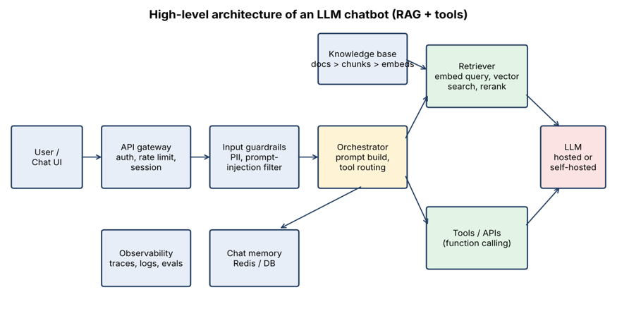

## What are the key architectural components to create a chatbot based on LLM? Please explain the approach on a high-level

A production chatbot is more than just the model; it is a pipeline built around the model. At a high level, the user's message passes through the gateway and input guardrails. The orchestrator then builds a prompt from the conversation memory, retrieved knowledge and tool results. The large language model generates a response, and an output check runs before the reply is delivered to the user.

| Component | Role and key decisions |
|---|---|
| Client / UI and API gateway | Chat UI (web, WhatsApp, Slack). Gateway handles authentication, rate limiting, session IDs, streaming (SSE/WebSocket). |
| Input guardrails | PII redaction, prompt-injection and jailbreak detection, topic filtering, input size limits. Critical for security: untrusted text must never be treated as instructions. |
| Orchestrator | The brain of the app (LangGraph, LangChain or custom). Decides per turn whether to answer directly, retrieve documents or call a tool; builds the system prompt, history and context; manages retries and fallbacks. |
| LLM | Hosted API or self-hosted open-weight model. Chosen by quality, latency, cost, context window and data-privacy needs. Optionally fine-tuned (LoRA/QLoRA) for tone or domain. |
| Knowledge and retrieval (RAG) | Offline: load documents, clean, chunk, embed, store in a vector DB with metadata. Online: embed the query, search (hybrid dense plus keyword BM25), rerank, and inject top chunks with source IDs so answers can cite them. This grounds the model and reduces hallucination. |
| Memory | Short-term: recent turns in the prompt (trimmed or summarised). Long-term: user facts and past sessions in Redis or a database. |
| Tools / function calling | The LLM requests structured calls (search, DB lookup, booking, ticket creation). The orchestrator validates arguments and enforces least-privilege permissions per user. |
| Output guardrails | Schema validation, groundedness check, toxicity and data-leak filters, refusal handling. |
| Observability and evaluation | Tracing (LangSmith, OpenTelemetry), token and cost tracking, logging, offline eval sets (retrieval recall, answer faithfulness), user feedback, regression tests on prompts. |
| Deployment | Containerised services (Docker/Kubernetes), caching of embeddings and frequent answers, async workers, secrets management, per-tenant isolation. |
